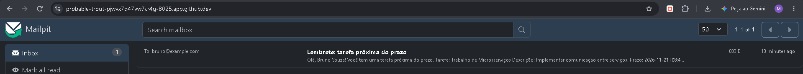
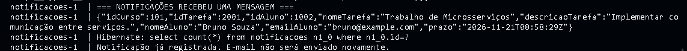
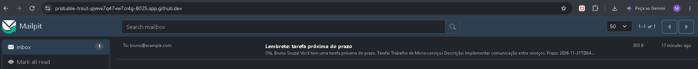
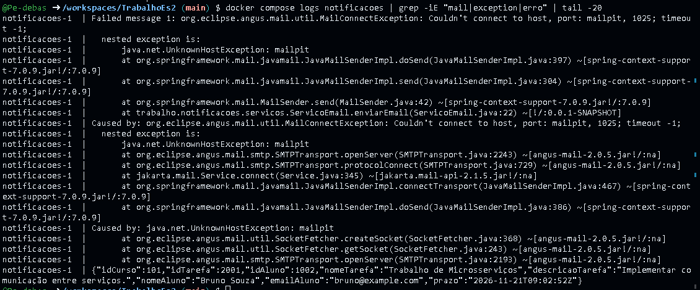
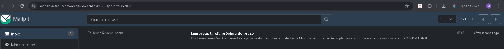

Serviço de reengajamento de estudantes integrado ao Moodle

Projeto extensionista – Engenharia de Software II (2026/2)

Serviço que envia por e-mail um lembrete ao aluno que ainda não entregou uma tarefa do Moodle com prazo nas próximas 24 horas. O lembrete traz o nome da tarefa, a descrição e o prazo, para convidar o estudante a retomar sua participação.

Autor: Pedro Gonçalves Trarbach

Vídeo de Apresentação: https://youtu.be/DB7nq8ldrNQ
---

Arquitetura

```
Moodle (simulado) ──REST──▶ Acompanhamento ──▶ RabbitMQ ──▶ Notificações ──SMTP──▶ Mailpit
                             (síncrono)        (assíncrono)
```

| Componente | Função |
|---|---|
| Acompanhamento | Consulta o Moodle periodicamente pelos webservices REST, identifica alunos com tarefa pendente que vence nas próximas 24 horas e publica uma solicitação de reengajamento na fila. |
| RabbitMQ | Fila solicitacoes-reengajamento, que desacopla os dois microsserviços. |
| Notificações | Consome a fila, monta e envia o e-mail por SMTP e registra o resultado em banco H2. Usa o identificador curso-tarefa-aluno para não reenviar o que já foi processado. Em caso de falha, o consumidor tenta novamente (3 tentativas, com espera crescente). |
| Mailpit | Servidor SMTP de teste, com interface web para ver os e-mails. |
| Moodle simulado | Servidor Python que imita os webservices do Moodle, com contas fictícias. |

Funções do Moodle utilizadas

| Função | Para quê |
|---|---|
| mod_assign_get_assignments | Tarefas e prazos |
| core_enrol_get_enrolled_users | Alunos matriculados |
| mod_assign_get_submissions | Quem já entregou |

Regras implementadas

- Só gera lembrete para tarefa com prazo entre agora e agora + 24 horas.
- Tarefas sem prazo, já vencidas ou já entregues são ignoradas.
- Um lembrete por aluno e tarefa.

---

Como executar

Requisitos: Docker e Docker Compose.

```
git clone https://github.com/Pe-debas/TrabalhoEs2
cd TrabalhoEs2
docker compose up --build
```

O primeiro build baixa as imagens e pode levar alguns minutos.

Endereços

| Serviço | Endereço |
|---|---|
| Mailpit (e-mails recebidos) | localhost:8025 |
| RabbitMQ (painel; usuário admin, senha admin123) | localhost:15672 |
| Moodle simulado | localhost:8000 |
| Notificações | localhost:8081 |

Configurações úteis

- Intervalo de consulta ao Moodle: variável ACOMPANHAMENTO_INTERVALO_MS do serviço acompanhamento no compose.yaml. Na demonstração está em 10000 (10 s). Em uso real, o padrão é 3600000 (1 hora).
- Zerar o histórico de envios: docker compose down -v e depois docker compose up --build.
- Parar tudo: Ctrl+C no terminal dos logs, ou docker compose down.

---

Dados de teste (contas fictícias)

Os dados ficam em acompanhamento/moodle-simulado/dados.json. Os prazos são calculados a partir do momento da consulta.

| Aluno | Tarefa 2001 – Trabalho de Microsserviços (prazo em 12 h) | Tarefa 2002 – Exercício de Docker (prazo em 48 h) |
|---|---|---|
| Ana Silva | entregue | pendente |
| Bruno Souza | pendente | entregue |

Resultado esperado: um único e-mail, para o Bruno, sobre a tarefa 2001.

---

Registro dos testes

Os testes usam contas fictícias e o Mailpit.

| N | Critério de aceite | Procedimento | Resultado esperado | Resultado obtido |
|---|---|---|---|---|
| 1 | Um lembrete para tarefa pendente dentro da janela de 24 h | docker compose up --build e abrir o Mailpit | 1 e-mail para Bruno Souza (tarefa 2001) | OK. 1 e-mail recebido, para Bruno Souza (tarefa 2001). Print: doc/prints/cenario1.png |
| 2 | Nenhum lembrete para tarefa já enviada ou fora da janela | Conferir a caixa do Mailpit | Nenhum e-mail para Ana (2001 entregue) nem para a tarefa 2002 (prazo em 48 h) | OK. Nenhum e-mail para Ana nem para a tarefa 2002. Print: doc/prints/cenario1.png |
| 3 | Nenhum novo envio ao reprocessar uma solicitação concluída | docker compose restart acompanhamento e aguardar novas rodadas | Nenhum e-mail novo; log de Notificações indica que a notificação já foi registrada | OK. O log de Notificações indicou notificação já registrada e o Mailpit permaneceu com 1 e-mail. Prints: doc/prints/cenario3LOG.png e doc/prints/cenario3MAILPIT.png |
| 4 | Registro de falhas e nova tentativa de processamento | docker compose down -v, docker compose up -d, docker compose stop mailpit, aguardar, docker compose logs notificacoes, docker compose start mailpit | Falha registrada nos logs; e-mail entregue depois que o Mailpit volta | OK. Com o Mailpit parado, Notificações registrou erro de conexão nos logs e tentou novamente; ao religar o Mailpit, o e-mail chegou. Prints: doc/prints/cenario4erroMAILPIT_desligado.png e doc/prints/cenario4erroMAILPIT_ligado.png |

Evidências

Cenários 1 e 2: um e-mail para o Bruno, nenhum para a Ana nem para a tarefa 2002.



Cenário 3: log de Notificações indicando notificação já registrada.



Cenário 3: Mailpit continua com um único e-mail.



Cenário 4: Mailpit desligado.



Cenário 4: Mailpit religado e e-mail entregue.



---

Estrutura do repositório

```
.
├── compose.yaml
├── acompanhamento/
│   ├── Dockerfile
│   ├── src/
│   └── moodle-simulado/
└── notificacoes/
    ├── Dockerfile
    └── src/
```

Tecnologias

Java 21, Spring Boot (Web, AMQP, Mail, Data JPA), RabbitMQ, H2, Mailpit, Docker e Docker Compose, Python 3 (Moodle simulado).

Referências

- Mailpit: mailpit.axllent.org/
- RabbitMQ: www.rabbitmq.com/
- Moodle: moodle.org/
- Moodle – Web service API functions: docs.moodle.org/dev/Web_service_API_functions
- Moodle – Using web services: docs.moodle.org/en/Using_web_services